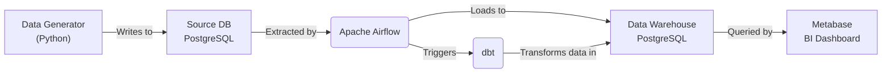

# Airflow Data Pipeline Example

     

This repository contains a simple example setup for a modern data stack running locally using Docker Compose. It demonstrates how to extract, load, and transform data using a combination of popular data tools.

## Architecture Pipeline



### Component Details

- **Data Generator (Python)**: A custom script that simulates real-time or batch data and inserts it directly into the Source Database.
- **Source DB (PostgreSQL)**: The transactional database (OLTP) where raw, operational data is generated and stored.
- **Apache Airflow**: The orchestrator that schedules and runs tasks. It extracts data from the Source DB, loads it into the Data Warehouse, and triggers dbt jobs.
- **Data Warehouse (PostgreSQL)**: The analytical database (OLAP) optimized for querying. It stores both the raw data loaded by Airflow and the transformed models built by dbt.
- **dbt**: Connects to the Data Warehouse to transform raw data into clean, aggregated data models ready for analysis using SQL.
- **Metabase**: The Business Intelligence tool connected to the Data Warehouse to visualize the data and build interactive dashboards.

## Tools Used

- **Apache Airflow**: Workflow orchestration to manage extraction, loading, and triggering transformations.
- **PostgreSQL**: Used as both the transactional source database and the analytical data warehouse.
- **dbt (Data Build Tool)**: In-warehouse data transformation and modeling.
- **Metabase**: Business intelligence and data visualization.
- **Docker & Docker Compose**: Containerization and local environment orchestration.

## Languages

- **Python**: Used for data generation, Airflow DAGs, and setup scripts.
- **SQL**: Used for dbt models and database initialization.
- **YAML**: Used for Docker Compose and dbt configuration.

## Environment Variables (`.env.local`)

This project uses environment variables to configure database connections and credentials. While Docker Compose reads from `.env` by default, it is a best practice to use `.env.local` for local development to avoid accidentally committing secrets.

1. Copy the example environment file:
   ```bash
   cp .env.example .env.local
   ```
2. Edit `.env.local` with your preferred credentials.
3. Start the services by explicitly pointing Docker Compose to your `.env.local` file:
   ```bash
   docker compose --env-file .env.local up -d --build
   ```

## Prerequisites

1. Install Docker Desktop: [https://www.docker.com/products/docker-desktop/](https://www.docker.com/products/docker-desktop/)

## Quick Start

1. If you are not using `.env.local` as described above, simply create a `.env` file from the example:
   ```bash
   cp .env.example .env
   ```

2. Open your terminal in this directory and run the following command to build and start the containers:
   ```bash
   docker compose up -d --build
   ```

3. Access the services:
   - **Airflow Web UI**: [http://localhost:8080](http://localhost:8080) (Username: `admin`, Password: `admin`)
   - **Metabase**: [http://localhost:3000](http://localhost:3000)

4. To stop the services:
   ```bash
   docker compose down
   ```

## Metabase Setup

To automatically configure Metabase, connect it to the Data Warehouse, and set up a sample dashboard after the containers are running:

1. Install the required Python dependencies (if not already installed):
   ```bash
   pip install -r requirements.txt
   ```

2. Run the setup script:
   ```bash
   python metabase/setup_metabase.py
   ```

3. Once completed, you can log into Metabase ([http://localhost:3000](http://localhost:3000)) using the following default credentials created by the script:
   - **Email**: `admin@example.com`
   - **Password**: `Password123!`

## Directory Structure

- `dags/`: Contains Directed Acyclic Graphs (DAGs) for Airflow.
- `dbt/`: Contains dbt project and SQL models.
- `data_generator/`: Python script to generate sample data into the source database.
- `postgres/`: SQL initialization scripts for source and data warehouse databases.
- `metabase/`: BI setup scripts (e.g., `setup_metabase.py`).
- `logs/`: Airflow task execution logs.
- `plugins/`: Custom Airflow plugins (if any).

## Notes:

- You may need to change the `FERNET_KEY` in `docker-compose.yml` for actual secure production usage.
- If you want to use a different executor (e.g., CeleryExecutor) or an external database, modify the environment variables in `docker-compose.yml` accordingly.
